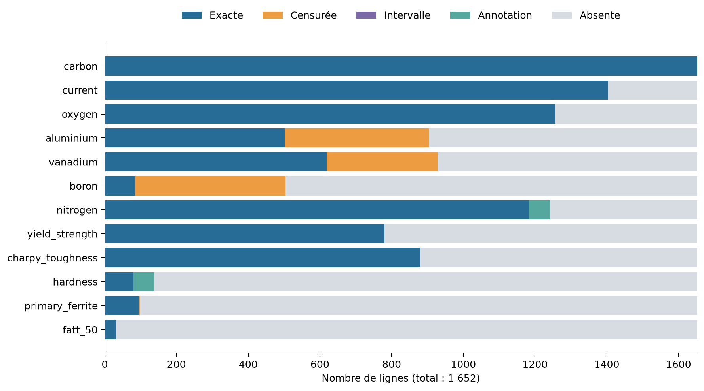
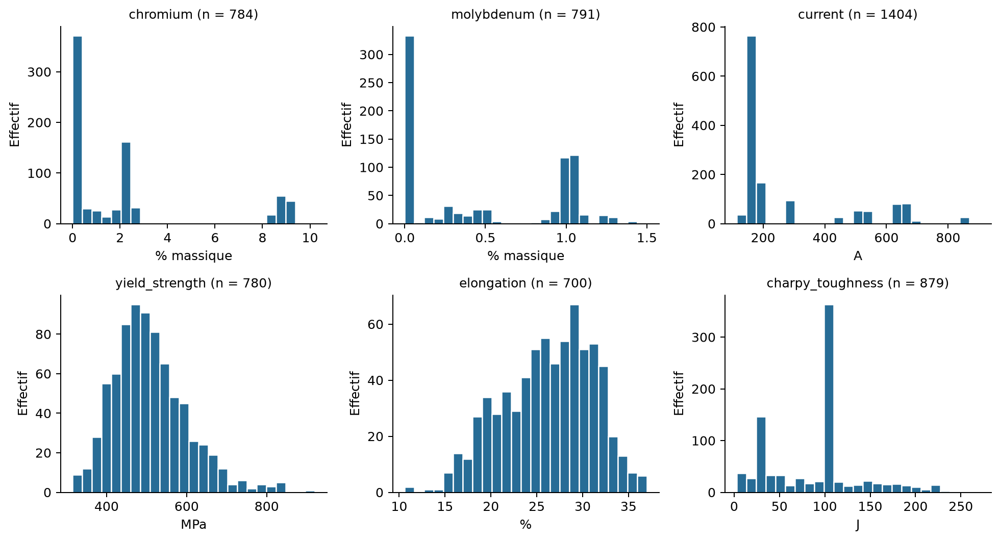

# Audit détaillé — Analyse descriptive et préparation des données

**Projet : prédiction de propriétés représentatives de la qualité des soudures.**  
**Date : 3 octobre 2026.**  
**Statut : rédaction intermédiaire ; unités suspectes, cible et protocole à confirmer.**

Cette annexe de travail analyse les données brutes et les sorties de l'audit transmis dans la conversation. Les dénombrements et statistiques ont été vérifiés sur `data/raw/welddb.data`. Aucune correction d'unité, imputation, ACP ou expérience prédictive n'a été appliquée. Les propositions ci-dessous restent à décider et à consigner dans `specs/spec.md`. La [version synthétique destinée à la première partie du rapport](01_eda_report.md) reprend les principaux constats. Cette annexe ne remplace pas les sections de méthodes et de résultats.

## 1. Nature et disponibilité des mesures

La base comporte **1 652 lignes et 44 colonnes**, couvrant composition chimique, paramètres de soudage, traitement thermique, propriétés mécaniques et microstructure. Les unités mélangent pourcentages massiques, ppm massiques, ampères, volts, kJ/mm, degrés Celsius, heures, MPa, joules et pourcentages. La documentation décrit une compilation de publications et précise que `N` signifie « valeur non rapportée », sans signifier zéro. [Documentation Cambridge](https://www.phase-trans.msm.cam.ac.uk/map/data/materials/welddb-b.html)

Le carbone, le silicium, le manganèse, l'apport thermique et le procédé sont renseignés sur toutes les lignes. La température entre passes est également renseignée, mais comprend 38 intervalles. En revanche, les disponibilités des autres variables diffèrent fortement. Il n'existe aucune ligne complète sur les 44 colonnes : supprimer toutes les lignes contenant au moins une absence supprimerait la totalité de la base.

La figure 1 distingue les valeurs numériques exactes, les limites de mesure, les intervalles, les annotations et les absences. « Exacte » signifie ici une valeur numérique sans annotation dans le fichier, et non une mesure exempte d'incertitude expérimentale.

*Figure 1 — Répartition des 1 652 lignes par statut de mesure. Les valeurs censurées et annotées constituent de l'information rapportée, même lorsqu'elles ne peuvent pas être utilisées directement comme nombres.*

| Variable | Numériques exactes | Censurées | Intervalles ou annotations | Absentes |
| --- | ---: | ---: | ---: | ---: |
| Aluminium | 502 | 403 | 0 | 747 |
| Vanadium | 620 | 308 | 0 | 724 |
| Bore | 85 | 419 | 0 | 1 148 |
| Niobium | 453 | 299 | 0 | 900 |
| Azote | 1 183 | 0 | 59 | 410 |
| Température entre passes | 1 614 | 0 | 38 | 0 |
| Dureté | 80 | 0 | 58 | 1 514 |
| FATT 50 | 31 | 0 | 0 | 1 621 |

*Tableau 1 — Disponibilité des variables particulièrement concernées par la censure ou les annotations. Tous les effectifs ont pour total 1 652.*

L'aluminium possède 905 valeurs rapportées, mais **44,5 % de celles-ci sont censurées**. Pour le bore, cette proportion atteint **83,1 %**. Les histogrammes calculés seulement sur les valeurs exactes représentent donc un sous-ensemble sélectionné. La censure ne doit pas être confondue avec l'absence d'une mesure.

## 2. Ordres de grandeur et structure des distributions

Les statistiques du tableau 2 portent sur les valeurs numériques exactes et conservent les unités annoncées dans la documentation.

| Variable | Unité documentée | Minimum | Médiane | Maximum |
| --- | --- | ---: | ---: | ---: |
| Carbone | % massique | 0,029 | 0,074 | 0,18 |
| Silicium | % massique | 0,04 | 0,32 | 1,14 |
| Manganèse | % massique | 0,27 | 1,27 | 2,25 |
| Oxygène | ppm massiques | 132 | 423 | 1 650 |
| Azote sans annotation | ppm massiques | 21 | 83 | 552 |
| Intensité | A | 115 | 170 | 900 |
| Tension | V | 11,5 | 21 | 75,36 |
| Apport thermique | kJ/mm | 0,6 | 1 | 7,9 |
| Température entre passes, hors intervalles | °C | 20 | 200 | 300 |
| Température Charpy | °C | −114 | −40 | 188 |

*Tableau 2 — Ordres de grandeur observés. L'accord avec une plage large ne démontre pas que les unités sont homogènes entre publications.*

Les distributions du carbone et du silicium présentent une concentration principale avec une queue vers les grandes valeurs. Celles du manganèse, du chrome et du molybdène comportent plusieurs concentrations de valeurs. Le chrome présente notamment des groupes autour de faibles teneurs, de 2 % et de 9 %. Ces structures suggèrent un mélange de familles de compositions ou de séries expérimentales ; cette interprétation doit être confrontée aux identifiants et aux sources. La figure 2 illustre cette hétérogénéité.

*Figure 2 — Histogrammes de six variables, avec 25 classes par panneau. Seules les valeurs numériques exactes sont représentées, sans correction d'unité, imputation ou suppression d'extrêmes. Les pics dépendent aussi du choix des classes.*

Le nickel, le cuivre et plusieurs éléments minoritaires sont concentrés vers de faibles valeurs, avec des queues à droite. Les valeurs élevées de soufre et de phosphore, respectivement 0,14 % et 0,25 %, apparaissent ensemble dans dix lignes de la série `Mart-G…`. Leur concentration dans une série justifie un examen de provenance plutôt qu'une suppression automatique par une règle statistique.

L'intensité et la tension présentent plusieurs régimes. Les 30 lignes à 850–900 A appartiennent toutes au procédé codé `SA`, tandis que l'intensité médiane est de 170 A. La comparaison par procédé est donc nécessaire avant de traiter ces valeurs comme des anomalies. Les pics d'apport thermique, de température entre passes et de traitement après soudage peuvent refléter des réglages répétés. Les 610 couples de traitement `(0 °C, 0 h)` pourraient coder un état sans traitement : ce sens doit être confirmé avant de les interpréter comme une température physique ou de les remplacer.

Les variables microstructurales ne disposent que de 89 à 98 valeurs rapportées par colonne. Leurs distributions décrivent un sous-ensemble réduit ; elles ne permettent pas de généraliser la composition microstructurale de toute la base. Les zéros observés ne sont pas assimilés à des valeurs manquantes.

Enfin, la modalité brute `MMA` compte 1 140 lignes, contre 261 pour `SA`. Le déséquilibre des procédés et les répétitions de séries limitent la représentativité des histogrammes globaux. Les synonymes documentés, comme `ShMA` et `MMA`, pourront être regroupés explicitement. La polarité `0`, rencontrée sur 38 lignes, demande une clarification de son encodage.

## 3. Cohérence physique et incertitudes d'unité

Les valeurs numériques examinées respectent les bornes physiques générales utilisées : concentrations non négatives, fractions et réduction de section entre 0 et 100 %, températures Celsius au-dessus du zéro absolu, durées et propriétés mesurées non négatives lorsque pertinent. Sur les **714 lignes où les deux résistances sont présentes**, aucune limite d'élasticité ne dépasse la résistance maximale en traction.

Ce résultat est un contrôle de cohérence élémentaire, **pas une validation métallurgique complète ni une preuve d'homogénéité des unités**. Les contrôles excluent les valeurs censurées et annotées. En particulier, `fatt_50` apparaît avec zéro violation dans la sortie, mais aucune borne ne lui a été appliquée car son unité n'était pas explicitée. Il ne faut donc pas présenter cette variable comme validée.

Plusieurs indices demandent un retour aux sources :

- **Aluminium :** dix lignes de la famille `EPRI-TR-101394s-…` contiennent 0,004 à 0,014 dans une colonne annoncée en ppm. Si ces valeurs étaient en pourcentage massique, elles correspondraient à 40–140 ppm. Cette conversion est une hypothèse, pas une correction établie.
- **Étain, arsenic et antimoine :** les mêmes 90 lignes possèdent simultanément des valeurs positives inférieures à 1 dans ces trois colonnes annoncées en ppm. Ce motif commun renforce l'intérêt d'un audit par publication, sans démontrer l'unité d'origine. Conditionnellement à une unité en % massique, 0,009 d'étain correspondrait à 90 ppm, 0,01 d'arsenic à 100 ppm et 0,008 d'antimoine à 80 ppm.
- **Titane :** la valeur 0,5 ppm de `Stil-TiB-1978-1.5Mn/BX200` mérite une vérification individuelle ; une petite valeur ne suffit pas à établir une erreur.
- **Limites de mesure :** `<5` pour le vanadium annoncé en % massique, et `<0.01` pour le titane et l'aluminium annoncés en ppm, doivent être confrontés à leurs sources. Les 16 limites `<0.01` de titane et d'aluminium se trouvent dans la famille `PantK-1990-bw…`.

La conversion entre unités massiques est `1 % = 10 000 ppm`. Aucune multiplication systématique des petites valeurs par 10 000 n'est justifiée. Une normalisation statistique ne corrigerait pas une erreur d'unité.

## 4. Signification des valeurs particulières

Une valeur `<L` indique une observation censurée sous une limite. Remplacer automatiquement cette valeur par `L`, zéro ou une absence ferait perdre une partie de son sens. Le preprocessing devra conserver au moins la limite et le statut de censure. Une substitution telle que `L/2` ne pourra servir que d'approximation explicite, avec une analyse de sensibilité ; elle ne révèle pas la concentration réelle.

L'intervalle `150-200` concerne 38 températures entre passes. Des bornes 150 et 200 °C peuvent être conservées ; utiliser leur milieu, 175 °C, constitue une approximation documentée.

Les 59 annotations d'azote, comme `67tot33res` et `66totndres`, comportent des marqueurs et parfois deux valeurs. Le sens de `tot`, `res` et `nd` doit être vérifié avant de définir une règle d'extraction. La seconde valeur ne doit pas être fusionnée arbitrairement avec la première.

La dureté comporte 80 valeurs sans annotation et 58 valeurs annotées `Hv5`, `Hv10` ou `Hv30`. Ces marqueurs renvoient à un protocole Vickers dont les métadonnées doivent être conservées ; les essais Vickers reposent sur une indentation sous charge. [Présentation de la mesure de dureté par TWI](https://www.twi-global.com/technical-knowledge/job-knowledge/hardness-testing-part-1-074)

L'extraction descriptive des nombres annotés donne une plage de **143 à 467**, alors que l'histogramme des seules valeurs sans annotation s'arrête à **265**. Il masque donc une partie importante de la variabilité rapportée. Récupérer les nombres ne suffira pas à démontrer la comparabilité des protocoles ou des valeurs dépourvues de métadonnées.

## 5. Conséquences pour la définition de la qualité et la validation

| Propriété candidate | Nombre de mesures | Minimum | Médiane | Maximum |
| --- | ---: | ---: | ---: | ---: |
| Limite d'élasticité, MPa | 780 | 315 | 495 | 920 |
| Résistance maximale en traction, MPa | 738 | 447 | 575,5 | 1 151 |
| Allongement, % | 700 | 10,6 | 26,8 | 37 |
| Réduction de section, % | 705 | 17 | 75 | 83 |
| Énergie Charpy, J | 879 | 3 | 100 | 270 |

*Tableau 3 — Propriétés mécaniques candidates. Aucune cible ni classe « bonne/mauvaise soudure » n'a encore été adoptée.*

Les résistances présentent une concentration principale et une queue vers les grandes valeurs. L'allongement est surtout concentré autour de 25–30 %, et la réduction de section vers 70–80 %. Ces formes sont descriptives et ne démontrent ni normalité ni relation causale entre composition et performance.

L'énergie Charpy comprend **356 valeurs à 100 J et 118 à 28 J**, soit 53,9 % des 879 mesures. Certaines observations pourraient décrire la température correspondant à une énergie fixée. Cette hypothèse doit être vérifiée avant de choisir entre prédiction d'énergie à température donnée et prédiction d'une température à énergie donnée. La caractérisation de soudures par température à énergie Charpy fixée existe dans la littérature. [Evans, exemple de température correspondant à 100 J](https://citeseerx.ist.psu.edu/document?doi=2bf148923f635a2095ff0d3963da62dd1b8561c9&repid=rep1&type=pdf)

Les labels de traction et Charpy sont souvent complémentaires : seules **144 lignes** possèdent à la fois la limite d'élasticité et l'énergie Charpy. Un modèle exigeant toutes les propriétés observées réduirait fortement l'échantillon. L'éligibilité doit être définie séparément pour chaque cible ; les absences de cible ne sont pas imputées comme des labels réels.

Les 1 652 lignes possèdent **1 490 identifiants distincts**, dont 91 répétés, concernant 253 lignes. Certains identifiants associent des essais Charpy à plusieurs températures. Il n'existe aucun doublon exact sur les 44 colonnes, mais quatre répétitions apparaissent lorsqu'on ignore l'identifiant ; leur nature reste à examiner. Les identifiants différents peuvent également correspondre à des variantes liées. Une validation aléatoire par ligne risquerait donc une contamination entre entraînement et évaluation. La règle de regroupement doit être justifiée après inspection des soudures, variantes et publications.

## 6. Prochaines étapes, dans l'ordre

1. **Achever l'audit de provenance.** Vérifier les unités des familles EPRI, PantK, Mart et Ditt, le sens des annotations d'azote, la polarité `0`, les valeurs nulles de traitement et les protocoles de dureté. Pour chaque correction confirmée, enregistrer la source, les lignes concernées, l'unité d'origine et la conversion dans `specs/spec.md` ; préserver les données brutes.
2. **Définir la cible et le moment de prédiction.** Une régression de la limite d'élasticité constitue une proposition de départ, avec 780 mesures et 872 lignes sans cette cible. Choisir les entrées réellement disponibles dans le scénario étudié ; ne pas inclure automatiquement les autres résultats mécaniques ou la microstructure. La tâche Charpy exige d'abord l'audit des valeurs à énergie fixée.
3. **Inspecter les dépendances et construire les groupes.** Examiner les répétitions exactes, les variantes et les sources. Définir une validation par groupes adaptée à l'objectif de généralisation, avec des partitions communes aux modèles. Comparer la disponibilité et les distributions des entrées entre observations étiquetées et non étiquetées.
4. **Proposer un preprocessing documenté.** Distinguer absence, censure, intervalle et annotation ; étudier l'intérêt des variables très peu renseignées. Après nettoyage déterministe, comparer une imputation simple des entrées et des indicateurs d'absence pertinents. Ne pas éliminer automatiquement les extrêmes ni les zéros.
5. **Compléter l'exploration et l'ACP.** Examiner les distributions par procédé et source, ainsi que les relations entre entrées et cible, en indiquant les effectifs observés pour chaque paire. Réaliser une ACP exploratoire sur des entrées numériques dont les unités et le traitement sont justifiés, avec imputation et standardisation explicites ; interpréter variance expliquée et contributions. Les structures peuvent refléter les publications et procédés plutôt que la qualité. Tout preprocessing destiné à la validation prédictive devra être réajusté dans les plis d'entraînement.
6. **Comparer les méthodes après fixation du protocole.** Établir une baseline constante, puis des modèles supervisés adaptés au cours, avec MAE, RMSE et R² pour une régression. Rapporter la variation entre plis et enregistrer seeds, paramètres et partitions. Rechercher et appliquer ensuite une méthode semi-supervisée de régression, en comparant son apport au modèle supervisé correspondant ; définir un protocole inductif ou transductif et exclure tous les labels de validation de l'entraînement et des pseudo-labels. Pour un protocole inductif, réserver les groupes de validation et leurs entrées à l'évaluation.

Ces étapes visent d'abord une base interprétable et un protocole rigoureux. Aucun effet bénéfique d'un réglage, aucune performance prédictive et aucune recommandation industrielle ne peuvent être déduits de ces seules distributions.

## Traçabilité de cette analyse

- Source locale : `data/raw/welddb.data`, colonne et unités d'après `data/raw/welddb.info`.
- SHA-256 du fichier de données : `eb46df81a454c8e549187d87c67a6e72b88676f760e8688a782c832737676ac1`.
- Vérification : lecture des 44 colonnes avec séparation par espaces et `N` comme absence ; classification des valeurs par forme textuelle ; statistiques et histogrammes sur les nombres sans annotation.
- Figures : produites directement depuis les données brutes, avec 25 classes pour chaque histogramme ; aucune transformation apprise, aucun échantillonnage aléatoire, aucune conversion d'unité ni suppression de ligne.
- Environnement d'analyse : pandas 3.0.6, NumPy 2.5.3. Les sorties détaillées de l'audit et le grand panneau d'histogrammes ont été transmis dans la conversation ; ils ne sont pas tous présents dans la version enregistrée du notebook au moment de cette rédaction.
- Les références externes sont liées près des affirmations qu'elles appuient. Les chiffres propres au dataset résultent des vérifications locales.
