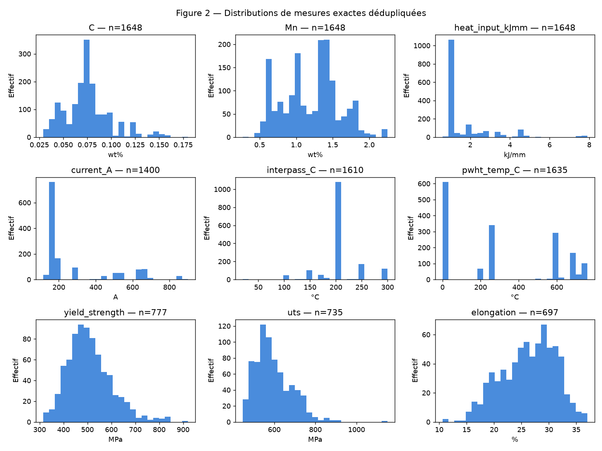
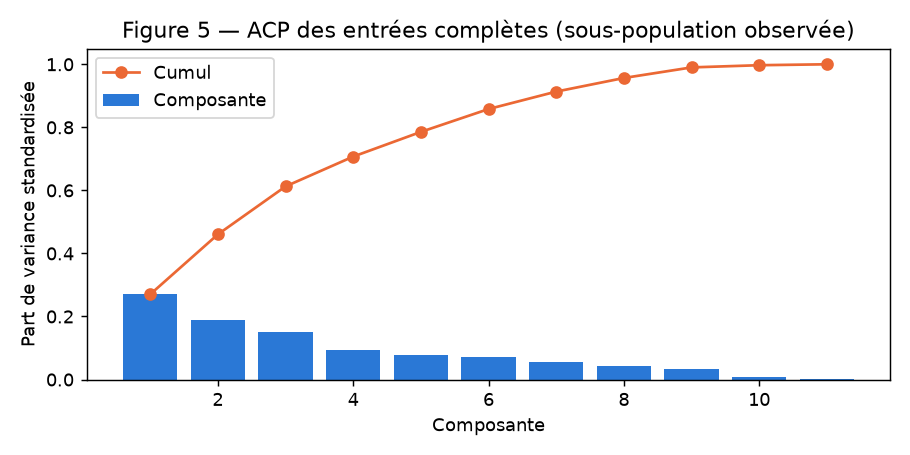

# Rapport intermédiaire — données et préparation avant entraînements

**État au 9 octobre 2026.** Les données, le protocole de traction et le premier
portefeuille de modèles sont définis. Ce document prépare le rapport final demandé
par le sujet ; il ne remplace pas encore les expériences réglées, la comparaison
semi-supervisée, les informations du binôme et le Gantt.

## Données et problème étudié

La base Cambridge Weld DB comporte 1 652 observations et 44 champs : composition
chimique, paramètres de soudage, traitements thermiques, propriétés mécaniques
et microstructure. Les unités mélangent wt%, ppm massiques, A, V, kJ/mm, °C, h,
MPa, J et %. Les fichiers d’origine restent inchangés. La documentation source
précise que `N` signifie non rapporté, sans signifier zéro ; voir
[la provenance et les unités](../data/README.md).

Nous retenons des régressions séparées de limite d’élasticité, résistance maximale
et allongement ; la réduction de section est complémentaire. Ces mesures décrivent
plusieurs aspects de la qualité. Aucun score universel ni seuil de qualité n’est
inventé. Une sortie manquante reste inconnue ; chaque tâche a ses propres labels.

| Population | Lignes | YS | UTS | Allongement | Réduction de section |
| --- | ---: | ---: | ---: | ---: | ---: |
| Brut | 1 652 | 780 | 738 | 700 | 705 |
| Dédupliqué | 1 648 | 777 | 735 | 697 | 702 |
| Cohorte principale | 1 555 | 706 | 677 | 631 | 635 |

*Tableau 1 — Effectifs de labels observés ; aucune propriété mécanique n’est imputée.*

## EDA conservée et ambiguïtés

L’EDA actuelle est concentrée dans 13 cellules : statuts des mesures, répétitions,
procédés, distributions sélectionnées, propriétés, Charpy et ACP descriptive.
La base contient 1 490 identifiants distincts, dont 91 répétés ; les quatre
répétitions exactes hors ID ne résument donc pas toutes les observations liées.
Les profils d’absence varient entre procédés ; nous ne les supposons pas aléatoires.

Les distributions de la figure 1 concernent les nombres exacts après retrait des
quatre doublons, avec l’effectif de chaque variable. Les extrêmes sont conservés :
leur amplitude ne démontre pas une erreur. Les corrélations de traction utilisent
uniquement les paires observées, avec leurs effectifs disponibles dans le notebook.

*Figure 1 — Populations et unités indiquées par panneau ; les valeurs censurées,
intervalles et annotations ne sont pas présentées comme nombres exacts.*

La préparation garde un token, statut, bornes et annotation pour chaque cellule
numérique, soit 66 080 cellules. `<L` est représenté par L/2 et les intervalles par
leur milieu, explicitement comme approximations. Les 322 cellules dont l’unité
est douteuse sont mises à NaN sans conversion ; les 59 annotations d’azote sont
conservées séparément, leur comparabilité restant non établie. Valeurs et protocoles
de dureté sont séparés. Les autres valeurs mesurées, dont les zéros PWHT, restent
préservées. Les seuls procédés fusionnés sont les synonymes documentés.

L’énergie Charpy et sa température doivent être interprétées ensemble. Après
retrait des doublons, 355 des 877 énergies valent 100 J et 118 valent 28 J. Les
signatures par série sont des hypothèses à vérifier dans les sources ; elles ne
valident pas une tâche à elles seules. E(T), T100J et T28J restent en attente.
La température Charpy n’entre pas dans les régressions de traction.

## ACP descriptive

L’ACP conserve onze entrées numériques : C, Si, Mn, S, P, courant, tension,
apport thermique, température entre passes, température et durée PWHT. Elle est
ajustée après standardisation sur les 1 339 lignes dédupliquées dont ces entrées
sont toutes des nombres exacts. Aucun remplissage n’est nécessaire dans ce
sous-ensemble ; il peut différer de la population complète.

PC1 et PC2 expliquent respectivement 27,02 % et 19,03 % de sa variance
standardisée, soit 46,05 % cumulés ; les trois premières expliquent 61,26 %.
PC1 donne notamment des poids élevés à l’apport thermique, au courant et à la
tension. Ces composantes décrivent des associations, pas des causes de qualité.

*Figure 2 — Variance des composantes et cumul sur 1 339 observations complètes.
Cette ACP descriptive n’est pas réutilisée pour évaluer les modèles.*

Les anciens essais d’ACP après différentes imputations et les benchmarks de
reconstruction restent dans le [rapport historique du 5 octobre](03_preprocessing_results.md)
et Git. Leur retrait de l’EDA allège l’exécution sans effacer les preuves. Les
scores de reconstruction sur onze entrées ne démontrent pas la reconstruction
sur la nouvelle cohorte treize entrées, ni celle des absences réelles.

## Préparation et protocole retenus

Le candidat principal comprend les onze entrées précédentes, oxygène et azote,
avec le procédé catégoriel. La cohorte exige au plus deux entrées numériques
indisponibles et exclut les doublons. Ses 1 555 lignes couvrent 44 groupes.
Ce seuil est un choix d’ingénierie, sans garantie de fiabilité. Les schémas 11/16
restent des comparaisons futures ; leur exclusion du candidat principal ne prouve
pas une absence d’effet physique.

Les groupes dérivent des identifiants et des liens de doublons, de façon
conservatrice ; ce ne sont pas encore des publications validées. Cinq plis
externes et trois plis internes par train externe sont enregistrés. Toutes les
méthodes partagent les mêmes validations pour chaque cible. Dans la cohorte,
un pli externe comprend 8–10 groupes et 103–166 labels selon la cible.

Standardisation, catégories et imputation itérative BayesianRidge sont ajustées
uniquement sur le train de chaque pli. Initialisation médiane, graine 42,
max_iter=100, tol=1e-3. Les valeurs observées restent intactes ; les PWHT estimés
respectent les couples du train et les composantes observées. Colonne absente,
non-convergence ou couple incompatible entraînent une erreur explicite.
Le nettoyage exporte les données avant apprentissage ; la CV repart de ces tables.
Le master garde donc ses NaN : 607 des 1 555 lignes de la cohorte ont au moins
une entrée numérique manquante, soit 1 075 cellules. Chaque entraînement réglé
refait son imputation dans le train du pli ; aucune table globalement imputée
n’est nécessaire avant de commencer la validation croisée.

Les 105 lignes dédupliquées sans aucune des cinq cibles sont conservées, dont
99 dans la cohorte. Une semi-supervision inductive pourra utiliser les lignes
sans la cible de la tâche depuis les groupes du train uniquement. La validation,
interne comme externe, reste exclue de l’apprentissage et des pseudo-labels.

## Contrôle d’imputation et limites actuelles

Le contrôle à paramètres fixes compare médiane/itérative sous Ridge et Random
Forest sur les mêmes plis, avec une baseline à la médiane de y du train.
Les quinze ajustements itératifs convergent en 4–7 itérations. Les huit exports
et tous les scores reproduisent la préparation AI corrigée auditée.

| Cible | Baseline MAE | RF/médiane MAE | RF/itérative MAE | RF/itérative R² moyen |
| --- | ---: | ---: | ---: | ---: |
| YS, MPa | 70,45 | 65,39 | 66,13 | 0,077 |
| UTS, MPa | 72,66 | 58,10 | 56,71 | 0,190 |
| Allongement, points de % | 4,09 | 3,70 | 3,55 | 0,114 |

*Tableau 2 — Moyennes non pondérées des cinq plis externes, paramètres fixes.
Ce contrôle de sensibilité ne constitue pas une sélection finale des modèles.*

L’itérative améliore plusieurs résultats, mais pas chaque cible/pli ; la médiane
est légèrement meilleure pour YS avec RF. Les R² sont modestes et leurs causes
ne sont pas isolées. Les dispersions par pli sont disponibles dans le notebook
et le CSV, sans être interprétées comme tests de significativité.

Les métriques finales seront MAE (moyenne des erreurs absolues), RMSE (racine de
la moyenne des erreurs au carré), dans l’unité de la cible, et R², sans unité.
Leur définition et les règles de comparaison sont dans [les specs](../specs/spec.md).

## Prochaine phase

Le notebook `03_modeling.ipynb` charge les données vérifiées, expose les pools et
les partitions, et configure médiane de y, Ridge, SVR RBF, Random Forest et kNN.
Les budgets sont explicités dans le [plan d’expériences](09_modeling_plan.md) et
[les specs](../specs/spec.md). Ces configurations ne sont pas encore des pipelines
entraînées. Il reste à vérifier leur adéquation au cours et exécuter les réglages
internes puis les évaluations externes. COREG est le candidat semi-supervisé à
implémenter et contrôler ; sa bibliographie n’établit aucun gain sur notre base.

Les ambiguïtés d’unités/Charpy, la sensibilité aux groupes et aux jeux d’entrées,
les erreurs de modèles et la reproduction par le binôme restent à documenter.
Aucune recommandation causale de réglage de soudure n’est établie. Le rapport
final, les responsabilités et les temps réels du Gantt seront complétés avec les
expériences. Voir [le compte rendu de migration](08_notebook_migration.md).
