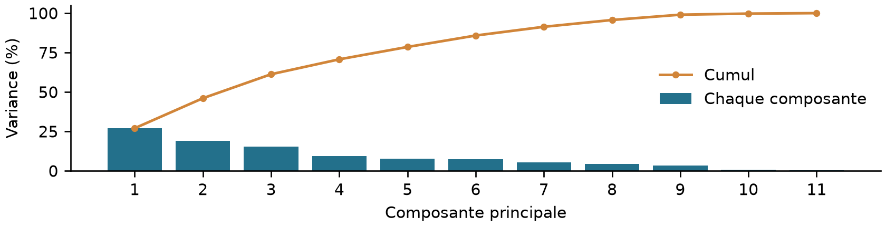
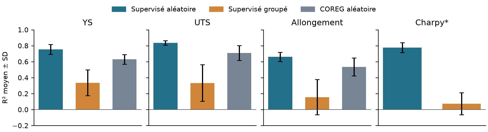

# Prédiction des propriétés mécaniques de soudures d’acier

**Rapport du projet - première version pour relecture - 10 octobre 2026**

**Auteurs : Mohamed SALH, Mohamed CHEBLI et Idriss BEN LETAIFA.**

**E-mails :** mohamed.salh@student-cs.fr ; mohamed.chebli@student-cs.fr ;
idriss.benletaifa@student-cs.fr. **Numéro d’équipe :** à renseigner.

## Résumé

Nous étudions la Cambridge Weld DB pour prédire trois propriétés de traction
et, de façon exploratoire, l’énergie Charpy à température connue. La préparation
conserve 1 555 observations ; cinq familles supervisées et COREG sont évaluées
avec des validations imbriquées aléatoire et par séries. La configuration retenue
utilise 16 entrées numériques, le procédé et une imputation médiane locale au
train. Les R² aléatoires vont de 0,660 à 0,836 pour la procédure supervisée ;
les R² groupés de 0,075 à 0,337. COREG ne l’améliore pas. Le transfert entre
séries et l’hétérogénéité des essais limitent les conclusions opérationnelles.

**Plan :** 1. Problématique ; 2. Données et cibles ; 3. Préparation et ACP ;
4. Méthodes ; 5. Validation ; 6. Résultats ; 7. Semi-supervisé ; 8. Diagnostics ;
9. Discussion ; 10. Conclusion ; 11. Organisation ; 12. Références.

## 1. Problématique et traduction en tâche de ML

L’énoncé vise à exploiter les données de soudage pour mieux caractériser la
qualité et compléter les connaissances expertes. Nous la représentons par
plusieurs propriétés mesurées, plutôt que par une classe arbitraire « bonne »
ou « mauvaise ». La tâche est une régression par cible à partir de compositions,
conditions de soudage et traitement thermique. Une sortie n’est jamais utilisée
pour prédire une autre. Les modèles séparés conservent les labels disponibles
pour chaque tâche, sans exiger toutes les sorties complètes.

## 2. Base de données et définition des cibles

La base issue de la littérature comporte 1 652 lignes et 44 champs [1]. Quatre
répétitions exactes hors identifiant sont écartées des expériences. La cohorte
principale retient 1 555 lignes et 44 séries inférées des identifiants et liens
de doublons, avec au plus deux entrées manquantes sur le noyau initial de 13.
Chaque groupe peut réunir plusieurs conditions : il n’est pas une éprouvette
unique certifiée. Le master conserve les NaN et la provenance du nettoyage.

**Tableau 1 - Cibles et labels éligibles dans la cohorte.**

| Cible | Information représentée | Unité | Labels |
| --- | --- | --- | --- |
| YS | Limite d’élasticité | MPa | 706 |
| UTS | Résistance maximale à la traction | MPa | 677 |
| Allongement | Déformation à rupture | % | 631 |
| Charpy* | Énergie à température d’essai connue | J | 861 |

YS et UTS sont corrélées (r=0,915 sur les paires exactes dédupliquées), mais
décrivent deux niveaux mécaniques distincts. L’allongement apporte une dimension
de déformation (corrélation avec UTS=-0,738). Cette matrice de corrélation n’est
pas une ACP. Dureté, FATT50 et réduction de section ne sont pas des sorties
retenues ; les autres propriétés et la microstructure restent hors des entrées.

*Charpy est exploratoire : température et énergie sont deux colonnes séparées ;
le modèle prédit E(T), pas T à énergie fixée. Certaines séries contiennent des
courbes apparentées, d’autres des points sélectionnés à une énergie de transition.
Toutes les sources ne sont pas harmonisées.*

<!-- pagebreak -->

## 3. Préparation, variables et ACP descriptive

`N` signifie non rapporté, jamais zéro [1]. Les limites `<L` utilisent L/2 et
les intervalles leur milieu, avec statut conservé. Les 322 cellules à unité
douteuse et les annotations d’azote restent indisponibles dans la représentation
principale. Les vrais zéros PWHT et les observations connues sont préservés.
Seuls des synonymes de procédés documentés sont fusionnés ; le brut reste intact.

Les 16 variables numériques sont C, Si, Mn, S, P, Ni, Cr, Mo (% massique),
O/N (ppm), courant (A), tension (V), apport thermique (kJ/mm), température
entre passes et PWHT (°C), durée PWHT (h). Le procédé est catégoriel ; Charpy
ajoute sa température connue. Ni/Cr/Mo manquent sur 58,8/53,2/53,0 % des lignes.
Leur ajout accroît l’information potentielle, sans ajouter d’observations.

Chaque train ajuste ses moyennes/écarts-types sur les nombres observés,
son encodage one-hot et ses médianes. Les transformations restent figées
pour la validation et le pool. Une catégorie inconnue devient un vecteur nul.
Les PWHT imputés doivent respecter des couples compatibles du train ; les
couples sont complets dans la cohorte actuelle. Ni les cibles ni la température
Charpy ne sont imputées. Une colonne totalement absente du train est refusée.

L’ACP est descriptive, sur 1 339 lignes dont onze entrées sont exactes et
complètes, après standardisation sans imputation. PC1 et PC2 expliquent
27,02 % et 19,03 % de variance, soit 46,05 % cumulés ; trois axes expliquent
61,26 % (figure 1). Ce sous-ensemble n’est pas toute la cohorte. Aucune de ces
transformations apprises globalement n’est réutilisée dans la CV prédictive.

## 4. Méthodes supervisées et choix du preprocessing

**Tableau 2 - Modèles, rôle et réglages internes.**

| Modèle | Rôle et choix internes |
| --- | --- |
| Médiane de y | Référence constante, aucun fit de X |
| Ridge | Régression linéaire L2 ; alpha=0,01 à 1 000 (six valeurs) |
| SVR RBF | Non-linéarité ; C=1/10/100, gamma=scale/0,05, epsilon=0,05/0,2 |
| RF | 300 arbres ; feuille=1/2/5, profondeur libre/10, max_features=0,5/1 |
| kNN | Régression locale ; k=3/5/9/15, distances L1/L2, poids uniformes |

La SVR standardise aussi y dans son train puis restitue son unité. Les 39
configurations, baseline incluse, sont choisies par MAE interne. La RF est un
contrôle non linéaire polyvalent, Ridge un contrôle linéaire et kNN le pendant
supervisé de COREG. Aucun algorithme n’est supposé optimal avant comparaison.
Les sensibilités 11/13/16 × médiane/itérative motivent 16/médiane : gains YS/UTS
et convergence robuste. L’itérative a 11 échecs, entraînant 44 évaluations
indisponibles sur 480. Ce choix est rétrospectif sur ces mêmes données.

<!-- pagebreak -->

## 5. Validation croisée et métriques

Les deux protocoles sont imbriqués : cinq validations externes, trois internes
pour sélectionner famille et paramètres ; tout preprocessing est appris dans
le train courant [3]. La CV aléatoire mélange les lignes (seed42 ; internes
seed43+pli). La groupée garde les séries séparées. Les estimateurs utilisent
seed42. La première mesure la prédiction dans une population représentée,
la seconde le transfert vers des séries absentes. Les groupes inférés restent
imparfaits ; une performance aléatoire élevée ne démontre pas IID.

Pour n labels yᵢ, prédictions ŷᵢ et moyenne ȳ de validation :

**MAE = (1/n) Σ |yᵢ - ŷᵢ|** ; **RMSE = √[(1/n) Σ (yᵢ - ŷᵢ)²]** ;
**R² = 1 - Σ(yᵢ - ŷᵢ)² / Σ(yᵢ - ȳ)².**

MAE règle les modèles ; RMSE pénalise davantage les grandes erreurs. R² peut
être négatif et n’a aucun minimum garanti de 0,5. Les tableaux donnent les
moyennes non pondérées des cinq plis. Les R² OOF réunis sont distincts ;
la dispersion entre plis n’est pas un intervalle de confiance.

## 6. Résultats supervisés, configuration 16/médiane

**Tableau 3 - Procédure de sélection interne, mêmes labels pour les deux CV.**
Les MAE sont en MPa, points de % ou J selon la cible ; Charpy* est exploratoire.

| Cible (unité) | MAE aléatoire | R² aléatoire | MAE groupée | R² groupé |
| --- | --- | --- | --- | --- |
| YS (MPa) | 31,630 | 0,755 | 56,757 | 0,337 |
| UTS (MPa) | 23,861 | 0,836 | 54,344 | 0,334 |
| Allongement (points de %) | 2,054 | 0,660 | 3,517 | 0,157 |
| Charpy* (J) | 16,461 | 0,776 | 35,752 | 0,075 |

**Tableau 4 - R² moyens par famille : A=aléatoire, G=groupé.**
Le classement externe décrit les performances ; il ne décide pas des exports.

| Famille | YS : A / G | UTS : A / G | Allong. : A / G | Charpy* : A / G |
| --- | --- | --- | --- | --- |
| Médiane de y | -0,031 / -0,073 | -0,050 / -0,180 | -0,015 / -0,062 | -0,069 / -0,149 |
| Ridge | 0,412 / -0,025 | 0,538 / 0,179 | 0,345 / 0,016 | 0,529 / 0,069 |
| SVR RBF | 0,754 / 0,264 | 0,836 / 0,316 | 0,556 / 0,106 | 0,749 / 0,091 |
| Random Forest | 0,765 / 0,390 | 0,805 / 0,394 | 0,660 / 0,226 | 0,795 / 0,138 |
| kNN | 0,619 / -0,140 | 0,697 / -0,115 | 0,530 / -0,060 | 0,651 / -0,099 |

La figure 2 montre la chute lors du transfert entre séries. En aléatoire, les
familles RF/SVR sont compétitives ; la sélection interne atteint 0,755/0,836/
0,660 pour la traction. En groupé, ses R² restent 0,337/0,334/0,157. La RF
isolée peut avoir un meilleur score externe que la sélection interne : cette
observation ne permet pas de sélectionner sur la validation. Les refits complets
sont réglés par une nouvelle CV5, et ne servent jamais à scorer les plis.

<!-- pagebreak -->

## 7. Semi-supervisé : COREG inductif

COREG utilise deux kNN échangeant des estimations jugées cohérentes localement
[2]. Notre variante a deux distances L1/L2 sur les mêmes entrées, k choisi dans
3/5/9/15 en interne et une sortie moyenne. Le gain local de SSE est mesuré après
insertion temporaire de la propre estimation du régresseur source, puis le
candidat est transmis à l’autre régresseur. Son voisinage courant comprend les
pseudo-labels précédents. Ces estimations ne sont pas des mesures mécaniques.

Le pool naturel global comprend 849/878/924 lignes sans YS/UTS/allongement.
Dans chaque pli, seuls les X du train sont accessibles ; les X et labels de
validation sont exclus, ainsi que leurs séries en groupé : protocole inductif.
Le preprocessing est appris sur les vrais labels et figé. Le pool transformé
est dédupliqué et les X déjà représentés parmi les vrais labels sont retirés ;
les vrais labels répétés restent conservés. Cette politique est une variante
du projet. Elle ne certifie pas l’identité physique de représentations égales.

Au plus 100 candidats actifs, 100 tours, un ajout par régresseur/tour et aucun
ID ajouté deux fois. Gain > `1e-12 × max(1,var(y_train)) × k` ; arrêt si pool
épuisé, aucun gain positif dans le pool actif ou budget atteint. Aucun label
de validation ne sert à accepter ou arrêter. Le contrôle principal est la
moyenne des mêmes kNN au même k, sans pseudo-labels, avec mêmes vrais labels.

**Tableau 5 - COREG, A=aléatoire / G=groupé ; gain positif=amélioration de MAE.**
Les MAE sont moyennes des plis ; les gains sont appariés sur les OOF.

| Cible | MAE COREG A / G | R² COREG A / G | Gain OOF même k A / G |
| --- | --- | --- | --- |
| YS | 37,919 / 71,074 | 0,629 / -0,056 | 0,322 / -0,272 |
| UTS | 33,037 / 63,060 | 0,709 / 0,043 | 0,283 / -0,920 |
| Allongement | 2,402 / 3,904 | 0,535 / -0,028 | -0,011 / -0,024 |

Les petits gains aléatoires YS/UTS ont des intervalles descriptifs couvrant zéro
(bootstrap par séries, 2 000 tirages). L’allongement ne progresse pas ; les
trois gains groupés sont négatifs. Pour UTS groupé, intervalle [-1,939 ; -0,275]
MPa. Les seeds de bases 43/44, avec k fixé, donnent la même lecture. COREG reste
moins bon que la sélection supervisée dans les six cas. Aucun entraînement
COREG Charpy n’est possible avec le pool naturel actuel à température connue.

## 8. Diagnostics et explicabilité

Le RF initial 13/itérative apprend le train mais transfère mal : R² train
YS/UTS=0,795/0,842 contre 0,079/0,194 groupés. Environ 56/51 % de sa SSE
proviennent des biais moyens de séries. Ce diagnostic vise le benchmark
initial, pas automatiquement les modèles 16/médiane. À médiane identique,
ajouter Ni/Cr/Mo donne des gains MAE OOF RF de 11,06 MPa YS et 8,80 MPa UTS,
avec intervalles descriptifs positifs ; allongement/Charpy sont moins établis.

La permutation de blocs du RF initial indique une information utilisée dans
la composition et PWHT ; la température d’essai est utile pour Charpy (+7,47 J
de MAE lorsqu’elle est permutée). Corrélations, permutations et contributions
des chemins d’arbres ne prouvent aucun effet causal. Un gain local COREG peut
renforcer une erreur commune sans corriger le décalage entre séries.

<!-- pagebreak -->

## 9. Discussion et recommandations

Le partage de séries explique un contexte plus favorable en aléatoire : 99 à
100 % des validations partagent une série avec le train. Pour Charpy, 65 %
partagent une condition, parfois à une autre température. Un contrôle RF à
paramètres fixes confirme que séparer des séries est plus difficile que séparer
les seules signatures répétées. Le protocole principal doit suivre l’usage,
plutôt que maximiser le R² affiché. Les validations externes ont déjà informé
le choix 16/médiane : une étude indépendante reste nécessaire.

Charpy conserve une réserve spécifique : deux familles de courbes E(T)
apparentées sont confirmées (174 points), une famille à 100 J semble issue
de températures de transition (31 points), et 21 groupes restent non résolus.
La thèse de Cool [4] emploie également des entrées différentes ; ses résultats
ne sont pas directement comparables. Il faut harmoniser les protocoles.

Les recommandations étayées sont de mieux mesurer les compositions manquantes,
enregistrer conditions et protocoles, identifier les éprouvettes/séries et
valider sur de nouvelles séries avec vrais labels. Aucun réglage de soudage
optimal, seuil universel de qualité ou substitution aux essais mécaniques
n’est démontré par ces associations. Leur validation demanderait des essais
contrôlés et l’avis de spécialistes du domaine.

## 10. Conclusion

La référence retenue est supervisée, avec 16 variables et médiane locale au
train ; la famille dépend de la cible et de la CV interne. COREG satisfait
l’étude semi-supervisée demandée mais n’améliore pas ce benchmark à budget
complet de labels. La priorité est le transfert entre séries et la qualité
des mesures. Les 188 pipelines sont exportées ; 37 tests et les audits OOF
valident le calcul. Ces contrôles ne constituent pas une validation industrielle.

## 11. Organisation et trame Gantt à compléter

Le journal de travail est vide : aucune heure ou responsabilité n’est inventée.
Le tableau 6 prépare le Gantt final. Il faut renseigner les dates, le membre et
les heures, puis tracer les barres sur ces dates. Les durées de calcul ne sont
pas des durées de travail humain. La revue croisée par l’équipe reste à documenter.

**Tableau 6 - Trame de saisie du Gantt ; temps et partage réels à renseigner.**

| Tâche réalisée / prévue | Membre | Dates début / fin | Heures réelles |
| --- | --- | --- | --- |
| EDA et lecture des sources | À compléter | À compléter | À compléter |
| Préparation et protocole | À compléter | À compléter | À compléter |
| Modèles supervisés | À compléter | À compléter | À compléter |
| Diagnostics et explicabilité | À compléter | À compléter | À compléter |
| COREG et contrôles | À compléter | À compléter | À compléter |
| Rédaction et revue croisée | À compléter | À compléter | À compléter |

## 12. Références bibliographiques

[1] Cool, T. et Bhadeshia, H. K. D. H. [Documentation Cambridge MAP_DATA_WELD](https://www.phase-trans.msm.cam.ac.uk/map/data/materials/welddb-b.html), colonnes et unités, consultée le 10 octobre 2026.

[2] Zhou, Z.-H. et Li, M. (2005). [Semi-Supervised Regression with Co-Training](https://www.ijcai.org/Proceedings/05/Papers/0689.pdf). IJCAI, p. 908-913.

[3] Scikit-learn. [Cross-validation: evaluating estimator performance](https://scikit-learn.org/stable/modules/cross_validation.html), consultée le 10 octobre 2026.

[4] Cool, T. (1996). [Design of Steel Weld Deposits](https://www.phase-trans.msm.cam.ac.uk/2012/Cool_Thesis.pdf), thèse, Cambridge, section 6.4 ; contexte Charpy et variables supplémentaires.

[5] Projet, notebooks 01 à 07 et rapports 10 à 14 : protocoles, résultats locaux et audits reproductibles, 10 octobre 2026.

La [synthèse globale](15_synthese_globale_resultats_fr.md) contient les dispersions,
RMSE, sensibilités, paramètres complets et preuves des rapports 10 à 14.
