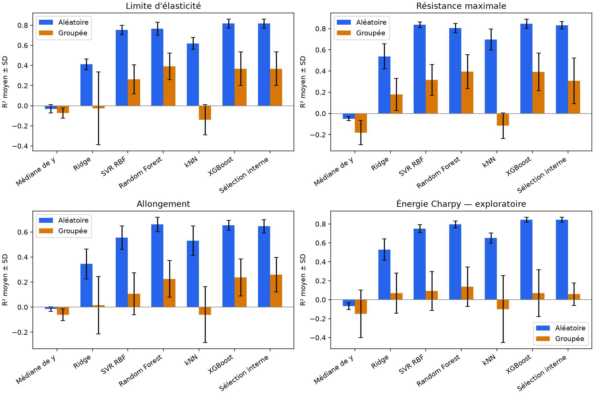

# XGBoost entraîné et benchmarks étendus — 12 octobre 2026

Code et sorties : [08_xgboost.ipynb](../notebooks/08_xgboost.ipynb).
Décisions : [specs/spec.md](../specs/spec.md). Expérience locale
`data/processed/experiments/salh_xgboost_v1/`, modèles
`models/salh_xgboost_v1/`, ignorés par Git.

## Protocole et population

Même cohorte strict13 : 1 555 lignes/44 séries ; labels YS=706, UTS=677,
allongement=631, Charpy=861. Quatre régressions séparées, aucun label imputé.
16 entrées numériques + procédé, température d'essai connue ajoutée pour
Charpy E(T), qui demeure exploratoire. N/NaN signifient absence de mesure,
pas zéro. Compositions en % massique, O/N en ppm, courant A, tension V,
apport thermique kJ/mm, températures °C, durée PWHT h. Sorties : MPa/MPa,
points de %, J. Autres propriétés mécaniques, IDs et groupes exclus de X.

Cinq plis externes et trois internes des notebooks 02/05/06, mêmes IDs et
labels entre familles. Aléatoire : seed42, internes seed43+pli. Groupé :
séries séparées à chaque niveau, même proxy conservateur inspecté auparavant.
Moyennes/écarts-types, catégories, médianes et garde PWHT ajustés uniquement
dans le train courant. Aucun eval_set externe ni early stopping. La préparation
commune conserve une comparaison à imputation identique ; la gestion native
XGBoost des NaN n'est pas évaluée. Le modèle utilise seulement les vrais labels,
aucun pool ni pseudo-label. COREG reste inductif et conserve ses entraînements.

XGBRegressor, booster gbtree, objectif `reg:squarederror`, histogrammes CPU,
seed42, n_jobs=1. Grille fixée avant calcul : profondeur=2/4/6,
learning_rate=0,03/0,1, n_estimators=150/300, **12 configurations**.
Fixes : min_child_weight=5, subsample=0,8, colsample_bytree=0,8,
reg_lambda=1, reg_alpha=0, gamma=0, max_bin=256. La MAE interne sélectionne
paramètres et familles, même si l'objectif appris est quadratique.
12 configurations comme RF/SVR ; ce budget comparable ne garantit ni temps
égal ni réglage optimal de chaque famille. Les petits arbres et la
régularisation limitent la complexité ; aucune grille n'a été élargie après
lecture des validations externes. Six familles = **51 configurations**,
baseline incluse. [Paramètres officiels XGBoost](https://xgboost.readthedocs.io/en/stable/parameter.html),
consultés le 12 octobre 2026.

## Résultats XGBoost

Moyennes non pondérées et SD des cinq plis, distinctes des scores OOF réunis.
Les MAE/RMSE ont l'unité de la cible ; SD des plis n'est pas un intervalle de
confiance. R² peut être négatif. Tous les plis terminent sans fallback.

| CV | Cible | MAE ± SD | RMSE moyen | R² ± SD | MAE OOF | R² OOF |
| --- | --- | --- | --- | --- | --- | --- |
| Aléatoire | YS (MPa) | 26,334 ± 2,735 | 39,147 | 0,816 ± 0,043 | 26,327 | 0,815 |
| Aléatoire | UTS (MPa) | 22,542 ± 2,245 | 34,863 | 0,845 ± 0,044 | 22,543 | 0,846 |
| Aléatoire | Allongement (points de %) | 2,021 ± 0,146 | 2,858 | 0,654 ± 0,039 | 2,021 | 0,655 |
| Aléatoire | Charpy* (J) | 14,151 ± 0,724 | 19,707 | 0,845 ± 0,026 | 14,150 | 0,847 |
| Groupée | YS (MPa) | 54,363 ± 9,820 | 70,263 | 0,367 ± 0,167 | 55,147 | 0,383 |
| Groupée | UTS (MPa) | 50,215 ± 6,720 | 65,165 | 0,392 ± 0,178 | 49,581 | 0,477 |
| Groupée | Allongement (points de %) | 3,322 ± 0,381 | 4,196 | 0,238 ± 0,148 | 3,297 | 0,263 |
| Groupée | Charpy* (J) | 35,450 ± 11,126 | 45,293 | 0,069 ± 0,247 | 35,571 | 0,161 |

XGBoost obtient la plus faible MAE moyenne des familles individuelles en
aléatoire pour les quatre cibles. En groupé, sa MAE est légèrement plus basse
que RF pour l'allongement (3,322 contre 3,339), mais RF reste plus basse pour
YS/UTS/Charpy. Le R² aléatoire de l'allongement XGBoost reste inférieur à RF
malgré sa MAE plus basse : les deux métriques ne classent pas toujours pareil.
Ces écarts descriptifs ne sont pas des preuves de significativité ni un motif
pour sélectionner une famille sur les scores externes. Les limites de transfert
entre séries et d'hétérogénéité Charpy persistent.



## Sélection interne actualisée entre six familles

Les recherches historiques des cinq familles sont réutilisées après vérification
de leurs hashes et minima internes ; la sélection à six compare seulement les
MAE internes. Égalités : ordre historique puis XGBoost. Si une ancienne famille
est sélectionnée, son pipeline est réentraîné sur le train externe et doit
reproduire ses OOF. Les expériences historiques ne sont pas écrasées.

| Cible (unité) | MAE aléatoire ± SD | R² aléatoire ± SD | MAE groupée ± SD | R² groupé ± SD |
| --- | --- | --- | --- | --- |
| YS (MPa) | 26,334 ± 2,735 | 0,816 ± 0,043 | 54,363 ± 9,820 | 0,367 ± 0,167 |
| UTS (MPa) | 23,604 ± 0,765 | 0,830 ± 0,035 | 55,691 ± 12,936 | 0,307 ± 0,215 |
| Allongement (points de %) | 2,064 ± 0,225 | 0,646 ± 0,053 | 3,278 ± 0,374 | 0,260 ± 0,138 |
| Charpy* (J) | 14,151 ± 0,724 | 0,845 ± 0,026 | 36,267 ± 12,771 | 0,058 ± 0,119 |

L'ajout d'une famille ne garantit pas l'amélioration de la procédure de
sélection : sa MAE externe baisse dans cinq des huit comparaisons. Elle augmente
pour l'allongement aléatoire (2,054 → 2,064), UTS groupé (54,344 → 55,691)
et Charpy groupé (35,752 → 36,267). Ces choix proviennent des scores internes,
sans correction après lecture des validations externes.

Familles choisies dans les cinq trains externes de chaque cible :

| CV | Cible | Famille | Plis |
| --- | --- | --- | --- |
| grouped | Charpy* (J) | Médiane de y | 2 |
| grouped | Charpy* (J) | SVR RBF | 2 |
| grouped | Charpy* (J) | XGBoost | 1 |
| grouped | Allongement (points de %) | Random Forest | 1 |
| grouped | Allongement (points de %) | XGBoost | 4 |
| grouped | UTS (MPa) | Ridge | 1 |
| grouped | UTS (MPa) | SVR RBF | 1 |
| grouped | UTS (MPa) | XGBoost | 3 |
| grouped | YS (MPa) | XGBoost | 5 |
| random | Charpy* (J) | XGBoost | 5 |
| random | Allongement (points de %) | Random Forest | 1 |
| random | Allongement (points de %) | XGBoost | 4 |
| random | UTS (MPa) | SVR RBF | 2 |
| random | UTS (MPa) | XGBoost | 3 |
| random | YS (MPa) | XGBoost | 5 |

Le notebook exporte `benchmark_outer_metrics.csv`, `benchmark_outer_predictions.csv`
et `metrics_summary.csv` pour les six familles et cette procédure. La comparaison
actuelle COREG figure dans `supervised_coreg_summary.csv` ; l'ancienne référence
`supervised_inner_selected` à cinq familles est remplacée dans ce tableau
uniquement. Les contrôles au même k et les gains de pseudo-étiquetage restent
inchangés. COREG reste moins performant que la sélection à six dans les six
comparaisons traction/protocole, sans démontrer un effet causal de XGBoost sur
la valeur du pool.

## Refits complets et exports

Nouvelle CV5 de choix : KFold shuffle seed1042 sur les labels triés ou
GroupKFold5 sans shuffle. Scores de sélection, **aucun test indépendant**.
Les cinq familles conservent leurs refits précédents ; XGBoost ajoute les siens.
L'index `models/salh_xgboost_v1/selected_models.json` pointe vers le meilleur
refit CV5 parmi les six pour chaque cible/protocole, parfois dans un dossier
historique. Il est distinct des index à cinq familles des notebooks 05/06.

| CV de choix | Cible | Famille | MAE de sélection | Paramètres |
| --- | --- | --- | --- | --- |
| Aléatoire | YS (MPa) | XGBoost | 26,698 | {"model__learning_rate": 0.1, "model__max_depth": 6, "model__n_estimators": 300} |
| Aléatoire | UTS (MPa) | XGBoost | 21,609 | {"model__learning_rate": 0.1, "model__max_depth": 6, "model__n_estimators": 300} |
| Aléatoire | Allongement (points de %) | XGBoost | 1,919 | {"model__learning_rate": 0.1, "model__max_depth": 6, "model__n_estimators": 150} |
| Aléatoire | Charpy* (J) | XGBoost | 13,437 | {"model__learning_rate": 0.1, "model__max_depth": 6, "model__n_estimators": 300} |
| Groupée | YS (MPa) | XGBoost | 57,742 | {"model__learning_rate": 0.1, "model__max_depth": 2, "model__n_estimators": 150} |
| Groupée | UTS (MPa) | SVR RBF | 46,555 | {"model__regressor__C": 10, "model__regressor__epsilon": 0.05, "model__regressor__gamma": 0.05} |
| Groupée | Allongement (points de %) | XGBoost | 3,252 | {"model__learning_rate": 0.1, "model__max_depth": 2, "model__n_estimators": 300} |
| Groupée | Charpy* (J) | Random Forest | 32,375 | {"model__max_depth": 10, "model__max_features": 0.5, "model__min_samples_leaf": 1} |

88 nouveaux pipelines : 40 XGBoost externes, 40 sélections externes actualisées,
huit XGBoost complets. Ils s'ajoutent aux 188 exports précédents, soit **276**
pipelines locales (certaines sélections ont la même famille que précédemment).
Les refits complets ont vu tous les labels et ne servent jamais à scorer les plis.

## Vérification et reproduction

- 40 évaluations XGBoost ; 480 configurations internes enregistrées (1 440
  validations), 96 configurations CV5 complète (480 validations).
- **1 968 fits XGBoost**, refits inclus ; 280 évaluations supervisées réunies
  (240 familles + 40 sélections), 40 250 prédictions OOF supervisées.
- Audit des IDs/labels/plis/groupes et recalcul des 280 triplets MAE/RMSE/R² ;
  les 40 sélections utilisent uniquement la meilleure MAE interne.
- **88 exports rechargés dans un processus neuf**, 11 580 prédictions
  vérifiées, écart absolu maximal 1.14e-13. Les 80 modèles externes
  reproduisent toutes leurs OOF ; les huit refits reproduisent dix sondes chacun.
- 41 tests rapides passent, dont quatre nouveaux tests XGBoost : preprocessing
  local aux trains internes, sélection indépendante des scores externes,
  export et température Charpy requise, agrégation moyenne/OOF distincte.

Versions réellement utilisées : Python 3.14.8,
XGBoost 3.4.1, scikit-learn 1.9.1,
NumPy 2.5.3, pandas 3.0.6.
Durée de l'exécution complète : 1.40 minutes,
qui n'est pas du temps de travail humain. Manifestes de sources, hash du brut,
hash des sources notebook, paramètres, splits, métriques et hashes des exports
sont enregistrés dans `manifest.json`.

```bash
uv sync --locked
# Choisir le noyau de .venv, exécuter 01 → 02 → 03 → 04 → 05 → 06 → 07 → 08.
.venv/bin/python -m unittest discover -s tests -v
```

Le benchmark initial 13/itérative et les sensibilités 11/13/16 × imputations
restent des expériences historiques ; aucune valeur XGBoost n'y est inventée.
L'ajout demandé après les diagnostics demeure rétrospectif sur ces données,
sans validation indépendante de l'ensemble de la démarche. Aucun réglage de
soudage optimal ni recommandation causale n'en est déduit.
