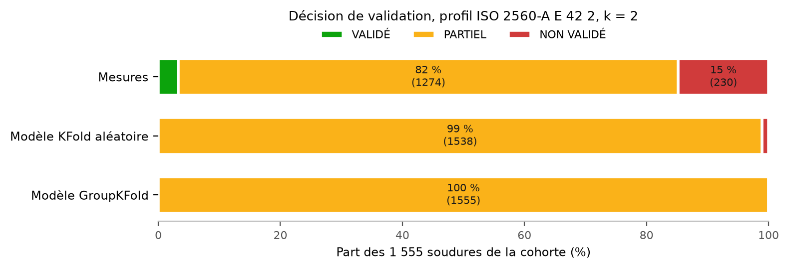

# Seuils par cible et règle de validation — recherche normative, 12 octobre 2026

Statut : **profil P2 (ISO 2560-A E 42 2) et k = 2 retenus par l'utilisateur
le 12 octobre 2026**, implémentés dans
[notebooks/09_validation.ipynb](../notebooks/09_validation.ipynb) ; résultats en
section 7. Les autres préférences suivent les recommandations de la section 6.
Les seuils viennent de normes citées ; ils définissent une exigence
d'application choisie, pas un score universel de « bonne soudure » (voir
[specs/spec.md](../specs/spec.md)).

## 1. Ce que l'on valide et contre quelle référence

Cibles : limite d'élasticité YS (MPa), résistance à la traction UTS (MPa),
allongement A (%), énergie Charpy KV (J) à une température d'essai T (°C).

La base décrit surtout du **métal fondu** : dans la cohorte strict13, 1 121 des
1 555 lignes sont en MMA, 227 en SA. Les normes de **classification des
consommables** (ISO 2560, ISO 18275, AWS A5.1) testent exactement ce métal
fondu pur. Ce sont donc les références directes. Les normes de **qualification
de procédé** (ISO 15614-1, DNV-OS-C401) testent un joint et renvoient aux
exigences du métal de base. Elles servent à choisir un niveau d'exigence
par application, pas à fixer une valeur unique.

Une classe comme « E 42 2 » impose **simultanément** la traction et la
résilience. C'est la logique demandée : toutes les cibles doivent passer leur
seuil pour valider.

## 2. Exigences relevées

### 2.1 ISO 2560-A : électrodes enrobées, aciers non alliés et à grains fins (système 47 J)

Tableau 1A, vérifié sur l'édition 2002 et identique dans le guide TWI de
l'édition actuelle :

| Symbole | YS min (MPa) | UTS (MPa) | A min (%) |
| --- | ---: | ---: | ---: |
| 35 | 355 | 440–570 | 22 |
| 38 | 380 | 470–600 | 20 |
| 42 | 420 | 500–640 | 20 |
| 46 | 460 | 530–680 | 20 |
| 50 | 500 | 560–720 | 18 |

- YS = ReL s'il y a un palier, sinon Rp0,2. Longueur entre repères = 5 × diamètre.
- Résilience (tableau 2A) : température à laquelle la **moyenne de 3 éprouvettes
  atteint 47 J**. Z : pas d'exigence ; A : +20 °C ; 0 : 0 °C ; 2 : −20 ; 3 : −30 ;
  4 : −40 ; 5 : −50 ; 6 : −60 °C. Une seule valeur individuelle peut être
  inférieure à 47 J, sans descendre sous 32 J. Une classe obtenue à une
  température couvre toutes les températures supérieures.
- Système B (classement par UTS : 43/49/55/57) : 27 J. On teste 5 éprouvettes,
  on écarte la plus haute et la plus basse ; la moyenne des 3 restantes doit
  atteindre 27 J, et une seule peut être inférieure, sans descendre sous 20 J.
- L'introduction prévient que le rapport YS/UTS du métal fondu est souvent plus
  élevé que celui du métal de base. Égaler la limite d'élasticité ne garantit
  donc pas d'égaler la résistance à la traction.

### 2.2 ISO 18275-A : aciers à haute résistance (YS > 500 MPa)

Tableau 1A, vérifié sur l'aperçu de l'édition 2005 ; une édition 2026 existe et
reste à contrôler :

| Symbole | YS min (MPa) | UTS (MPa) | A min (%) |
| --- | ---: | ---: | ---: |
| 55 | 550 | 610–780 | 18 |
| 62 | 620 | 690–890 | 18 |
| 69 | 690 | 760–960 | 17 |
| 79 | 790 | 880–1 080 | 16 |
| 89 | 890 | 980–1 180 | 15 |

Le système de résilience à 47 J est le même que dans l'ISO 2560-A. L'allongement minimal
diminue quand la classe de résistance augmente.

### 2.3 AWS A5.1/A5.1M : électrodes en acier au carbone (système 27 J)

- E7018 (exigences AWS reprises par la fiche Lincoln) : YS ≥ 400 MPa (58 ksi),
  UTS ≥ 490 MPa (70 ksi), A ≥ 22 %, KV ≥ 27 J (20 ft·lbf) à −29 °C (−20 °F).
- E7018-1 : 27 J à −46 °C (−50 °F) (tableau 4 de l'édition 1981, ASME SFA-5.1).
- Compromis explicite dans l'édition 1981 (tableau 3, notes c et e) : chaque
  point d'allongement au-dessus du minimum autorise une baisse d'UTS et/ou de
  YS de 1 ksi (≈ 7 MPa), jusqu'à un plancher (E70 : 480/400 MPa).

### 2.4 Offshore (DNV) et éolien

- **DNV-OS-C401** (2004, amendé en 2005), ch. 2 sect. 1, C104–C112 :
  - la traction transverse du joint doit atteindre l'UTS minimale de la nuance ;
  - KV en métal fondu, ligne de fusion et ZAT : **même exigence que le métal de
    base en sens travers**, à la température de la nuance ;
  - la moyenne de 3 éprouvettes doit atteindre l'exigence ; une valeur peut
    être inférieure, sans descendre sous 70 % de cette moyenne ;
  - contre-essai : 3 éprouvettes de plus. La nouvelle moyenne doit atteindre
    l'exigence, au plus 2 valeurs peuvent être inférieures, et au plus une
    sous 70 % ;
  - entre deux nuances différentes, on applique l'exigence de la plus faible.
- **DNV-OS-B101** (2008), tableaux C5 et D4 : la lettre de nuance fixe la
  température (A : 0 °C, D : −20, E : −40, F : −60 °C). L'énergie croît avec la
  résistance. En sens long : 42/46/50/55/62/69 J pour 420/460/500/550/620/690 MPa,
  soit environ YS/10. En sens travers : 28/31/33/37/41/46 J. Pour NV 36
  (355 MPa, t ≤ 50 mm) : 34 J en long, 24 J en travers. Même règle des 70 %.
- **EN 10225** (acier des monopieux) : la fiche Industeel S355NL0 annonce 50 J
  minimum à −40 °C en travers. C'est une source secondaire.
- **Mehmanparast et al. (2018)**, S355 de monopieux : l'énergie Charpy moyenne
  du métal fondu est environ 30 % sous celle du métal de base. KV diminue quand
  la limite d'élasticité augmente, du métal de base à la ZAT puis au métal fondu.

### 2.5 Ductilité et rapport YS/UTS (critères optionnels, métal de base)

- EN 1993-1-1 §3.2.2, valeurs recommandées : fu/fy ≥ 1,10, allongement à
  rupture ≥ 15 % et εu ≥ 15 εy. EN 1993-1-12 (jusqu'à S700) relâche ces valeurs
  à 1,05 et 10 %.
- API 5L PSL2 : YS/UTS ≤ 0,93 sur le corps de tube (source secondaire).
- Nos données : YS/UTS moyen de 0,84 ; 6 % dépassent 1/1,10 et 2 % dépassent
  0,93 ; 0,6 % ont A < 15 %. Ces critères discriminent peu et ne visent pas le
  métal fondu. Ils restent optionnels.

### 2.6 Décider sous incertitude : JCGM 106:2012

- §8.2, acceptation simple (risque partagé) : la valeur est comparée directement
  à la limite de tolérance.
- §8.3.2, acceptation gardée : la limite d'acceptation est placée à l'intérieur
  de la tolérance, à une distance w = rU, avec U = 2u. Le choix courant r = 1
  (w = U) est la règle par défaut de l'ISO 14253-1. Il borne la probabilité
  d'accepter un non-conforme à 2,3 % sous hypothèse normale.
- §8.3.3, rejet gardé : la limite est placée à l'extérieur de la tolérance, pour
  ne rejeter qu'avec une preuve nette.
- Les deux combinés donnent **trois zones** : conforme, indéterminée, non
  conforme. C'est la base proposée pour le statut « partiel ».

## 3. Compromis à arbitrer

1. **Résistance ou allongement.** Les normes abaissent A min de 22 % à 15 %
   quand la classe monte, et l'AWS de 1981 permettait d'échanger l'un contre
   l'autre. Dans nos données, la corrélation de Spearman vaut ρ = −0,73 entre
   YS et A (622 soudures, 33 séries) et −0,79 entre UTS et A. Exiger une classe
   de résistance haute avec l'allongement d'une classe basse peut être
   irréaliste. Il faut garder le couple (YS, A) d'une même ligne de tableau.
2. **Résistance ou ténacité.** Selon Bhadeshia, le métal fondu « peut
   facilement être rendu résistant, mais sans capacité à absorber l'énergie ».
   Keehan et al. (2001) obtiennent 720–850 MPa avec jusqu'à 113 J à −40 °C,
   grâce à peu de Mn et 7–9 % de Ni. La composition peut donc déplacer le
   compromis, sans le supprimer. Dans nos données, seules 32 lignes (3 séries)
   ont à la fois YS et une énergie non codée. Sur les lignes T100J, ρ(YS, T100J)
   = +0,52 (111 lignes, 6 séries) : c'est cohérent avec le compromis, mais
   confondu par les séries et non concluant.
3. **Sur-résistance ou borne haute d'UTS.** Les fourchettes d'UTS des normes
   limitent la sur-résistance. Dans nos données, 27 % des UTS dépassent 640 MPa.
   Pour la classe 42, le taux de soudures conformes en traction passe de 71 %
   sans borne haute à 53 % avec.
4. **Niveau de résilience** : 27 J (AWS, ISO B) ou 47 J (ISO A), et la
   température (−20 °C ou −40 °C) selon l'application.
5. **Risque client ou risque producteur** (JCGM 106 §8.3.1.3) : élargir la
   bande de garde réduit les fausses acceptations mais augmente les faux rejets.
6. **Précision du modèle et pouvoir de décision** : avec l'erreur de la
   validation groupée, les bandes de garde deviennent très larges (§5.5).

## 4. Seuils proposés par cible

| Profil | Usage visé | YS (MPa) | UTS (MPa) | A (%) | KV moyen | Référence |
| --- | --- | ---: | ---: | ---: | --- | --- |
| P1 AWS E7018 | minimum « 27 J », référence US | ≥ 400 | ≥ 490 | ≥ 22 | ≥ 27 J à −29 °C | AWS A5.1 |
| **P2 ISO E 42 2 (défaut proposé)** | structure courante | ≥ 420 | 500–640 | ≥ 20 | ≥ 47 J à −20 °C | ISO 2560-A |
| P3 ISO E 42 4 | offshore, éolien, basse température | ≥ 420 | 500–640 | ≥ 20 | ≥ 47 J à −40 °C | ISO 2560-A ; nuances DNV E |
| P3b ISO E 46 4 | variante S420/S460 | ≥ 460 | 530–680 | ≥ 20 | ≥ 47 J à −40 °C | ISO 2560-A |
| P4 ISO E 55 4 | haute résistance | ≥ 550 | 610–780 | ≥ 18 | ≥ 47 J à −40 °C | ISO 18275-A |

P2 est proposé par défaut : sa classe de résistance est au centre des données
(médianes YS 496 MPa, UTS 576 MPa, A 26,6 %), −20 °C fait partie des
températures d'essai les plus fréquentes (76 couples), et le système 47 J est le
plus exigeant des deux systèmes ISO. P3 répond à l'exemple éolien du sujet ;
−40 °C compte 72 couples. Le minimum réglementaire DNV pour le métal fondu est
plus bas (24–28 J en travers à −40 °C) ; le choix de 47 J est donc prudent.

Taux de conformité sur les **labels observés** de la cohorte, pour vérifier que
les seuils discriminent :

| Profil | YS | UTS (dont > max) | A | 3 critères de traction (n = 609) | KV conforme / non conforme / indéterminé |
| --- | ---: | ---: | ---: | ---: | ---: |
| P1 | 91 % | 94 % | 79 % | 69 % | 56 / 1 / 42 % |
| P2 | 85 % | 61 % (27 %) | 89 % | 53 % | 49 / 5 / 46 % |
| P3 | 85 % | 61 % (27 %) | 89 % | 53 % | 34 / 8 / 57 % |
| P3b | 69 % | 58 % (18 %) | 89 % | 45 % | 34 / 8 / 57 % |
| P4 | 26 % | 34 % (3 %) | 95 % | 19 % | 34 / 8 / 57 % |

Pour KV observé, un seul couple E(T) est disponible. Il est conforme si
T ≤ T_req et E ≥ E_min, non conforme si T ≥ T_req et E < E_min, et
indéterminé sinon. Cette règle suppose que l'énergie augmente avec la
température dans la transition, ce qui vaut pour les aciers ferritiques. Les
lignes codées 28 J ou 100 J restent des couples E(T) ; aucune n'est reclassée.
Seules 141 lignes ont les quatre cibles observées. La fonction s'appuiera donc
surtout sur des prédictions.

**Variante « par classe » :** au lieu d'un profil fixe, la fonction peut
renvoyer la désignation la plus haute atteinte. Le symbole de résistance est la
ligne la plus haute dont YS, la fourchette d'UTS et A sont tous satisfaits ; le
symbole de résilience est la plus basse température où KV prédit atteint 47 J.
Elle produit par exemple « E 38 3 » au lieu d'un simple rejet pour E 42 4.

## 5. Règle de validation (implémentée dans le notebook 09)

### 5.1 Entrées

Pour chaque cible j : valeur ŷ_j (mesurée ou prédite), incertitude u_j, profil,
facteur k, ensemble des cibles critiques. KV est prédit **à T_req du profil** :
le modèle E(T) prend la température en entrée.

### 5.2 Statut par cible, avec w_j = k·u_j

- Borne basse L : **C** (conforme) si ŷ − w ≥ L ; **NC** (non conforme) si
  ŷ + w < L ; **I** (indéterminé) sinon.
- Borne haute H : **C** si ŷ + w ≤ H ; **NC** si ŷ − w > H ; **I** sinon.
- Fourchette [L ; H] : C seulement si les deux bornes sont C ; NC si l'une est NC.
- Cible absente (ni mesure ni prédiction) : **I**.

k = 2 reproduit w = U = 2u (JCGM 106, ISO 14253-1) ; k = 0 correspond à
l'acceptation simple. Pour une valeur mesurée, u est l'incertitude de mesure
(non fournie par la base) ; on prend alors w = 0.

### 5.3 Agrégation

- **VALIDÉ** : toutes les cibles sont C.
- **NON VALIDÉ** : au moins une cible critique est NC.
- **PARTIEL** : tous les autres cas, c'est-à-dire aucun NC critique, mais au moins
  un I, une cible absente ou un NC non critique. La soudure doit être confirmée
  par un essai réel, comme les contre-essais prévus par l'AWS et par la DNV
  (C110).

### 5.4 Incertitude u_j

L'incertitude u est la RMSE hors pli **réunie** (toutes les validations
externes) de la procédure de référence actuelle : sélection interne entre six
familles, XGBoost compris
([notebook 08](../notebooks/08_xgboost.ipynb), [rapport 17](17_xgboost_training.md)).
Les premières versions de ce rapport utilisaient la sélection à cinq familles du
[tableau `tab:synthese` du rapport LaTeX](../rapport_latex/sections/07_resultats_supervises.tex)
(45,2 / 36,0 / 2,84 / 23,5 en aléatoire ; 72,8 / 68,6 / 4,39 / 45,7 en groupé).

| Cible | RMSE aléatoire | RMSE groupée | n OOF |
| --- | ---: | ---: | ---: |
| YS (MPa) | 39,57 | 72,25 | 706 |
| UTS (MPa) | 36,62 | 70,72 | 677 |
| A (%) | 2,907 | 4,146 | 631 |
| KV (J) | 19,74 | 47,98 | 861 |

Pour une soudure d'une **nouvelle série ou d'une nouvelle famille de
procédé**, on prend la RMSE groupée. La RMSE aléatoire ne vaut que pour une
soudure proche de séries déjà vues.

### 5.5 Conséquences chiffrées pour P2 avec k = 2

Limites d'acceptation sur la valeur prédite, w = 2u :

| Critère | Aléatoire (w) : C si / NC si | Groupé (w) : C si / NC si |
| --- | --- | --- |
| YS ≥ 420 MPa | (79,1) ≥ 499,1 / < 340,9 | (144,5) ≥ 564,5 / < 275,5 |
| UTS ≥ 500 MPa | (73,2) ≥ 573,2 / < 426,8 | (141,4) ≥ 641,5 / < 358,6 |
| UTS ≤ 640 MPa | (73,2) ≤ 566,8 / > 713,2 | (141,4) ≤ 498,6 / > 781,5 |
| A ≥ 20 % | (5,8) ≥ 25,8 / < 14,2 | (8,3) ≥ 28,3 / < 11,7 |
| KV(−20 °C) ≥ 47 J | (39,5) ≥ 86,5 / < 7,5 | (96,0) ≥ 143,0 / jamais NC |

Lecture : la fourchette d'UTS fait 140 MPa de large. Elle devient **vide** dès
que 2w > 140 MPa, ce qui est le cas dans les deux scénarios : aucune prédiction
ne peut rendre `uts_min` et `uts_max` conformes ensemble. Le modèle ne peut
donc **jamais** prononcer VALIDÉ tant que `uts_max` participe à VALIDÉ (section 7).
En scénario groupé, le modèle Charpy ne peut jamais rejeter. Il ne faut pas
réduire k pour masquer ces limites : elles traduisent l'erreur des modèles,
cohérente avec les R² groupés de 0,06 à 0,37.

### 5.6 Limites

- La RMSE est une erreur globale qui suppose une erreur homogène. Les erreurs
  Charpy sont hétérogènes (couples codés 28/100 J). Amélioration recommandée :
  des intervalles de prédiction par soudure, par CV+/jackknife+ (Barber et al.,
  2021) ou par conformal split (Lei et al., 2018), calibrés sur les plis
  groupés sans fuite de labels de validation.
- Le modèle prédit une énergie moyenne. Les règles sur les valeurs
  individuelles (32 J sur 47 J ; 70 % ; 20 J sur 27 J) ne peuvent pas être
  vérifiées.
- La méthode de mesure de YS (ReL ou Rp0,2), la longueur entre repères de A et
  l'état (brut de soudage ou après traitement thermique) ne sont pas documentés
  ligne par ligne. Une classification ISO précise l'état ; un profil s'applique
  donc à l'état testé.
- Ces seuils valent pour le métal fondu, pas pour un joint (ZAT, métal de base
  et géométrie non modélisés).

## 6. Préférences

| Choix | Options | Retenu le 12 octobre 2026 |
| --- | --- | --- |
| Profil | P1, P2, P3, P3b, P4, ou mode « par classe » | **P2** (choix de l'utilisateur) |
| k | 0, 1 ou 2 | **2** (choix de l'utilisateur) |
| Incertitude u | RMSE aléatoire, RMSE groupée, intervalles conformes | RMSE du protocole évalué ; groupée pour une nouvelle soudure |
| Borne haute d'UTS | critique, informative ou ignorée | informative (recommandation) ; à revoir, voir section 7.4 |
| Cibles critiques | toutes les bornes basses, ou seulement YS + KV | toutes les bornes basses (recommandation) |
| Sens de « partiel » | indéterminé ; compte de cibles réussies ; déclassement | indéterminé (recommandation) |

## 7. Implémentation et résultats (notebook 09)

### 7.1 Protocole

- Code : [notebooks/09_validation.ipynb](../notebooks/09_validation.ipynb).
  Fonctions testées par [tests/test_validation.py](../tests/test_validation.py)
  (6 tests). Exports locaux, ignorés par Git, sous
  `data/processed/experiments/salh_validation_v1/`, avec un manifeste (hashes des
  entrées, modèles, sorties et versions).
- Population : les 1 555 lignes (44 séries) de la cohorte strict13, domaine
  d'entrée des modèles. Les 93 lignes hors cohorte ne sont pas prédites.
- **Mesures** : valeurs de la base, w = 0, car aucune incertitude de mesure
  n'est publiée. Une cible absente donne I. KV utilise la règle monotone sur
  l'unique couple E(T).
- **Modèles** : la procédure à six familles avec sélection interne
  (`models/salh_xgboost_v1/<protocole>/outer_selected/`). Chaque ligne est
  prédite par le modèle externe qui ne l'a pas vue ; en groupé, ce modèle n'a
  pas vu sa série non plus. Les deux protocoles ont des modèles et des RMSE
  différents. KV est prédit à −20 °C pour les 1 555 lignes. Les refits complets
  ont vu tous les labels : ils ne servent pas ici.
- Contrôles : les 80 chargements (40 modèles) sont vérifiés par hash.
  Aux entrées observées, les prédictions reproduisent exactement les OOF exportés
  par le notebook 08. Aucune ligne n'est dans le train de son modèle, et aucune
  série en groupé.

### 7.2 Décisions sur la cohorte (règle retenue)

| Source | VALIDÉ | PARTIEL | NON VALIDÉ |
| --- | ---: | ---: | ---: |
| Mesures | 51 (3,3 %) | 1 274 (81,9 %) | 230 (14,8 %) |
| Modèle KFold aléatoire | 0 | 1 538 (98,9 %) | 17 (1,1 %) |
| Modèle GroupKFold | 0 | 1 555 (100 %) | 0 |

- **Mesures** : seules 141 lignes ont les quatre cibles mesurées. Sur les
  1 274 PARTIEL, 1 253 ont au moins une cible absente. Les 21 autres ont un
  couple Charpy qui ne tranche pas à −20 °C (14) ou une UTS au-dessus de
  640 MPa (12). Les 230 NON VALIDÉ échouent sur YS (109), UTS min (83), A (72)
  ou KV (44), avec des recouvrements.
- **Modèles** : 0 VALIDÉ, conséquence directe de la fourchette d'UTS vide
  (§5.5). En aléatoire, 17 NON VALIDÉ (YS 4, A 9, KV 4). Aucun n'est VALIDÉ par
  la mesure ; 7 sont confirmés NON VALIDÉ, 10 ont une mesure incomplète.

### 7.3 Statut par critère et accord avec la mesure

Répartition des statuts prédits (C / I / NC) sur les 1 555 lignes :

| Critère | Aléatoire | Groupé | Mesures |
| --- | --- | --- | --- |
| `ys_min` | 723 / 828 / 4 | 280 / 1 275 / 0 | 597 / 849 / 109 |
| `uts_min` | 808 / 747 / 0 | 375 / 1 180 / 0 | 594 / 878 / 83 |
| `uts_max` | 711 / 660 / 184 | 65 / 1 453 / 37 | 495 / 878 / 182 |
| `el_min` | 895 / 651 / 9 | 460 / 1 095 / 0 | 559 / 924 / 72 |
| `kv_min` | 1 186 / 365 / 4 | 60 / 1 495 / 0 | 421 / 1 090 / 44 |

Accord, sur les lignes où la mesure tranche (C ou NC). Part tranchée = part
des lignes où la prédiction est C ou NC. Fausse acceptation = prédit C, mesuré
NC, rapporté au nombre de C prédits.

| Critère | Lignes tranchées par la mesure | Aléatoire : part tranchée, fausses acceptations | Groupé : part tranchée, fausses acceptations |
| --- | ---: | --- | --- |
| `ys_min` | 706 | 51 % ; 2/353 (0,6 %) | 16 % ; 2/112 (1,8 %) |
| `uts_min` | 677 | 52 % ; 0/350 | 19 % ; 0/130 |
| `uts_max` | 677 | 56 % ; 4/307 (1,3 %) | 9 % ; 1/43 (2,3 %) |
| `el_min` | 631 | 60 % ; 5/376 (1,3 %) | 27 % ; 1/173 (0,6 %) |
| `kv_min` | 465 | 86 % ; 1/399 (0,3 %) | 7 % ; 0/34 |

- Les fausses acceptations restent sous la borne de 2,3 % du JCGM 106 pour
  chaque critère, dans les deux protocoles. La bande k = 2 est donc prudente
  sur ces données. C'est une vérification rétrospective sur les mêmes données,
  pas une validation indépendante.
- Les rejets prédits sur une borne basse ne sont jamais contredits par la
  mesure. Pour `uts_max`, 1 rejet sur 70 en aléatoire et 3 sur 21 en groupé le
  sont.
- Le protocole groupé ne tranche que 7 % à 27 % des critères. Pour une
  nouvelle série, le modèle ne décide presque jamais seul.

### 7.4 Sensibilité à la borne haute d'UTS (non retenue, pour décision)

| Variante | Source | VALIDÉ | PARTIEL | NON VALIDÉ |
| --- | --- | ---: | ---: | ---: |
| `uts_max` critique | Mesures | 51 | 1 156 | 348 |
| | Aléatoire | 0 | 1 356 | 199 |
| | Groupé | 0 | 1 518 | 37 |
| `uts_max` ignorée | Mesures | 58 | 1 267 | 230 |
| | Aléatoire | 125 | 1 413 | 17 |
| | Groupé | 0 | 1 555 | 0 |

En ignorant `uts_max`, le modèle aléatoire valide 125 soudures. Pour 5
d'entre elles, la mesure confirme ; pour 2, elle donne NON VALIDÉ, soit 1,6 %
des VALIDÉ ; pour les 118 autres, la mesure est incomplète. Le modèle groupé
ne valide toujours rien. Rendre `uts_max` critique ajoute surtout des NON
VALIDÉ. En groupé, 2 soudures VALIDÉES par la mesure deviennent alors NON
VALIDÉ, à cause d'une UTS prédite trop haute.

### 7.5 Conclusions

1. Avec P2 et k = 2, le modèle **ne valide aucune soudure**, quel que soit le
   protocole : la fourchette d'UTS est plus étroite que deux bandes de garde.
   Pour obtenir des VALIDÉ, il faut choisir entre ignorer `uts_max`, un k plus
   petit, ou des modèles plus précis. C'est un choix de risque, pas un réglage
   technique.
2. En scénario aléatoire, proche de séries déjà vues, le modèle tranche environ
   la moitié des critères de traction et 86 % des critères Charpy, avec moins
   de 1,5 % de fausses acceptations par critère.
3. En scénario groupé (nouvelle série), le modèle tranche rarement : il sert à
   trier les candidats avant un essai, pas à qualifier une soudure.
4. Les mesures elles-mêmes ne permettent une décision complète que pour
   281 lignes (51 VALIDÉ et 230 NON VALIDÉ), faute de cibles mesurées
   ensemble.

Limites propres à cette évaluation : RMSE globale et homogène par cible ;
RMSE Charpy estimée aux températures observées et appliquée à −20 °C ; mesures
sans incertitude ; même jeu de données que celui ayant servi aux choix des
modèles.

## Sources

- ISO 2560:2002, aperçu officiel (tableaux 1A, 1B, 2A, §4.3A/B) :
  https://cdn.standards.iteh.ai/samples/35626/e216187634ce4fb68ef77afca2a42d40/ISO-2560-2002.pdf
- ISO 2560:2020, notice : https://www.iso.org/standard/79320.html
- TWI, Welding consumables part 3 (tableaux ISO 2560 actuels) :
  https://www.twi-global.com/technical-knowledge/job-knowledge/welding-consumables-part-3-084
- ELGA, Guide EN ISO 2560-A :
  https://elgawelding.com/wp-content/uploads/2021/07/ELGA-Classification_EN-ISO-2560-A-1.pdf
- ISO 18275:2005, aperçu SIS (tableau 1A) : https://www.sis.se/api/document/preview/905907/
  ; édition 2026 : https://www.iso.org/standard/90569.html
- ASME SFA-5.1 / AWS A5.1-81 (tableaux 3 et 4) :
  https://canteach.candu.org/Content%20Library/20053402.pdf
- Lincoln Electric, fiche 7018 AC (exigences AWS A5.1/A5.1M E7018) :
  https://ch-delivery.lincolnelectric.com/api/public/content/a04096fdb2b94eedbfcdbbeeba6de1dc?v=d00756f7
- DNV-OS-C401 (2004, amendé 2005) :
  https://rules.dnv.com/docs/pdf/dnvpm/codes/docs/2005-04/OS-C401.pdf
- DNV-OS-B101 (2008), tableaux C5, D4, E305 :
  https://rules.dnv.com/docs/pdf/dnvpm/codes/docs/2008-10/OS-B101.pdf
- Industeel S355NL0 (EN 10225) : https://industeel.arcelormittal.com/fichier/ds-offshore-s355nlo-gb/
- Mehmanparast, Taylor, Brennan, Tavares (2018), *Fatigue Fract. Eng. Mater.
  Struct.* :
  https://strathprints.strath.ac.uk/64716/1/Mehmanparast_etal_FFEMS_2018_Experimental_investigation_of_mechanical_and_fracture_properties_of_offshore_wind_monopile.pdf
- EN 1993-1-1 §3.2.2, annexe nationale de Chypre :
  https://moi.gov.cy/MOI/moiup/moi.nsf/all/05FE06BB537676ACC22585A100430DF8/$file/Cyprus_National_Annex_EN_1993-1-1.pdf
  ; STROBE (EN 1993-1-12) : https://steel-sci.com/assets/downloads/STROBE-Presentation-SS-Webinar-2.pdf
- API 5L PSL1 et PSL2 (secondaire) :
  https://blog.projectmaterials.com/quick-answers/pipes/api-5l-psl1-vs-psl2/
- JCGM 106:2012, §8.2–8.3 :
  https://www.bipm.org/documents/20126/2071204/JCGM_106_2012_E.pdf
- Bhadeshia, *Strong ferritic-steel welds* :
  https://www.phase-trans.msm.cam.ac.uk/2006/strong.html
- Keehan, Karlsson, Marimuthu, Andrén, Bhadeshia (2001), *High strength steel
  weld metals: developments with Ni and Mn* :
  https://www.phase-trans.msm.cam.ac.uk/2002/kobe.html
- Barber, Candès, Ramdas, Tibshirani (2021), *Ann. Statist.* 49(1), 486–507,
  https://doi.org/10.1214/20-AOS1965
- Lei, G'Sell, Rinaldo, Tibshirani, Wasserman (2018), *JASA* 113(523),
  1094–1111, https://doi.org/10.1080/01621459.2017.1307116

Toutes les sources ont été consultées le 12 octobre 2026. Les normes ISO, AWS
et EN complètes sont payantes : les valeurs viennent d'aperçus officiels,
d'anciennes éditions ou de reproductions, signalées comme telles ci-dessus.
